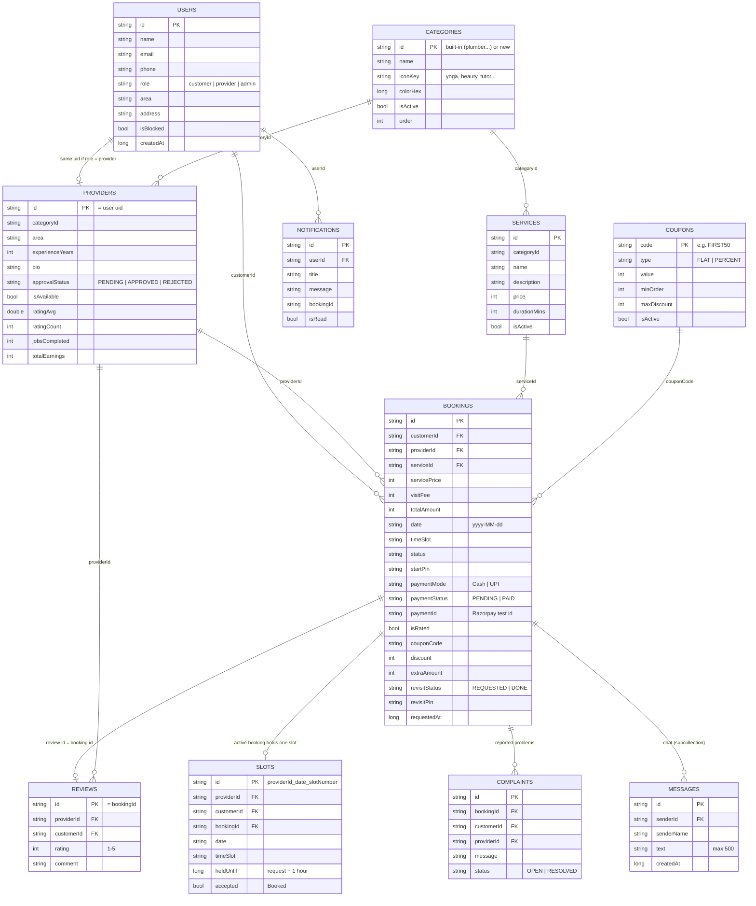
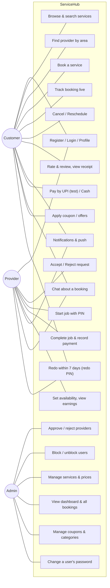
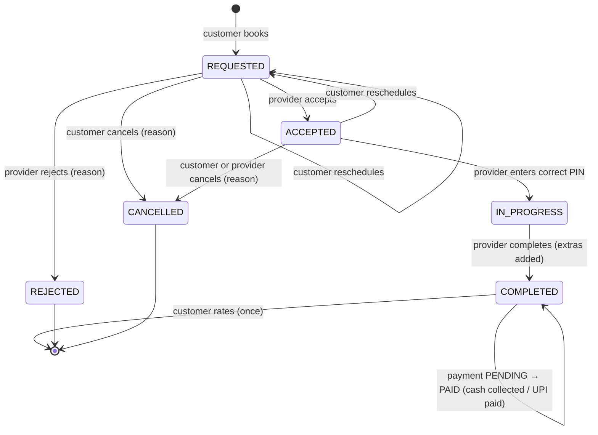
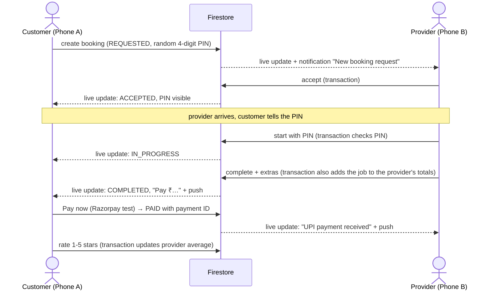

# ServiceHub – Report Kit

Diagrams are written in **Mermaid**. GitHub shows them as pictures automatically.
For your report: open this file on GitHub (or paste a diagram into https://mermaid.live),
then take a screenshot or export PNG.

---

## 1. Problem and solution (for the introduction)

Finding reliable local service providers is unorganized: people rely on word of mouth, cannot
compare prices, and cannot track a request. Providers have little digital visibility.
ServiceHub lets customers browse services with fixed prices, book an admin-verified provider in
their area and follow the job live, while providers manage requests and earnings and an admin
keeps the platform trustworthy.

## 2. Architecture (MVVM)

```mermaid
flowchart LR
    subgraph Phone["Android app (one Activity)"]
        UI["Screens<br/>(Jetpack Compose)"] -->|user actions| VM["ViewModels<br/>(StateFlow)"]
        VM -->|state| UI
        VM --> REPO["Repositories<br/>Auth · User · Service · Provider · Booking<br/>Review · Notification · Admin · Complaint · Coupon · Chat"]
        PAY["RazorpayPayments"]
        PUSH["PushService"]
    end
    REPO -->|login / logout| AUTH["Firebase Authentication"]
    REPO -->|read, write, transactions| FS[("Cloud Firestore")]
    FS -->|live updates (snapshot listeners)| REPO
    RULES["Security rules"] -.protect.- FS
    PAY -->|UPI test payment| RZP["Razorpay (test mode)"]
    REPO -->|change password, send push| SRV["Vercel server<br/>(Firebase Admin SDK)"]
    SRV --> AUTH
    SRV -->|push| FCM["Firebase Cloud Messaging"]
    FCM --> PUSH
```

**Explanation:** a screen only draws the state it gets from its ViewModel. The ViewModel holds
the screen's data in a StateFlow and calls a repository. Repositories are the only code that
talks to Firebase. Firestore pushes every change to all listening phones, so both phones stay in
sync without a refresh. Two things a phone app must never do itself (set another user's password,
send a push with the secret key) run on a tiny free Vercel server that checks the caller first.

## 3. Firestore structure



**Slots:** each active booking owns one `slots` document whose id is
`providerId_date_slotNumber`. Only one document can have that id, so only one booking can hold
a provider's slot. It is created in the same transaction as the booking and deleted when the
booking is rejected, cancelled or completed (or moved when rescheduled). While the provider has
not answered, other customers see the slot as **On hold**; after acceptance it is **Booked**. If
there is no answer within 1 hour (`heldUntil`), the hold ends and someone else may book it. It contains no address
or phone numbers, so bookings themselves stay private.

Areas and time slots are fixed lists in Kotlin code (`FixedData.kt`). Categories start with 6
built-in defaults in code; the admin can add new ones (e.g. Yoga Teacher) or hide any, stored in
`categories` and merged live by `CategoryStore`, so the platform can grow without an app update.
Names and phones are copied into each booking, so a booking still shows correct details even if
someone later edits their profile.

## 4. Use-case diagram



## 5. Booking status flow



Every move happens inside a **Firestore transaction** (`BookingRepository.changeBooking`): it
reads the current status and refuses any move that is not in the diagram.

**Expired:** a booking still REQUESTED after its date/slot has passed is shown as "Expired"
(grey), moves to Past/History and can no longer be accepted. The customer can reschedule,
cancel, or find another provider.

## 6. Booking sequence (two phones)



## 7. Screenshot checklist

Take these on a real phone (Power + Volume down):

- [ ] Splash · Login · Register (customer) · Register (provider fields)
- [ ] Waiting for approval · Admin approvals list
- [ ] Customer Home (categories) · Search results · Category services
- [ ] Provider list with area chips · Provider detail with reviews
- [ ] Booking form with price summary · Booking success
- [ ] My Bookings (Active / Past) · Booking detail: Requested, Accepted with PIN, Completed
- [ ] Reschedule dialog · Cancel dialog
- [ ] Provider Home (availability + earnings) · Jobs (requests) · Job detail: PIN entry, Complete dialog
- [ ] Notifications with unread badge
- [ ] Rate & review · Receipt
- [ ] Admin dashboard · Users (block) · Manage services (edit price) · All bookings filter
- [ ] Book a service form · Review page with Offers for you · slot "On hold" / "Booked"
- [ ] Customer Home "Needs your attention" · Pay now (Razorpay test) · Paid banner
- [ ] Chat · a push in the notification bar · Next step box
- [ ] Provider: Payments to collect · Cash collected · redo PIN
- [ ] Admin: Coupons · Booking detail · Change password · badges
- [ ] Firebase Console: Firestore collections · Authentication users list · Rules page · Vercel deployment

## 8. Future scope

Already built in this version (were future scope earlier): push notifications, UPI payment (Razorpay
test mode), in-app chat, coupons and offers, admin password change (free Vercel server).

Still for the future:
- **Server-side payment check** (Razorpay order + signature on the server) and server-side price/coupon calculation
- **Hide PINs from the provider's download** (needs server code to check the PIN)
- **Timed alerts** (e.g. the 1-hour "no answer" push even when the customer's app is closed) with a scheduled server
- Photos of the problem and provider ID documents (Firebase Storage needs the paid Blaze plan)
- Maps and live GPS tracking (Maps SDK needs a billing account; "Open in Maps" already works)
- Phone OTP login, email verification at registration
- Real (live-mode) payments after Razorpay KYC
- Dark mode, Hindi / Gujarati languages, provider working hours and custom slots
## 8b. What makes ServiceHub different (for the "unique features" section)

- **Race-proof booking:** a slot is claimed in the same transaction as the booking, so two
  customers can never get the same provider at the same time.
- **Start PIN:** the job can only start when the provider is really at the customer's home.
- **Live timeline with real times** (requested, accepted, started, completed) on both phones.
- **Trust signals:** admin-verified providers, "Top rated" only with 4.5★ from 3+ reviews,
  one review per completed booking.
- **Fair handling of no-shows:** unanswered requests expire automatically, late jobs show as
  "Overdue", and either side can cancel with a reason that the other side sees.
- **Transparent prices:** fixed service price + ₹49 visit fee shown before booking, a clear
  "spare parts are extra" note, receipt after, shareable on WhatsApp/SMS.
- **No trial and error:** taken slots and the provider's weekly days off are greyed out before
  the customer chooses; "⚡ Available today" finds someone for urgent jobs.
- **Weekly days off designed for urgency:** a day off belongs to one provider and only blocks
  NEW bookings; other providers stay bookable, and existing jobs are never cancelled silently.
- **7-day service guarantee with a redo PIN:** if the problem returns within 7 days, the customer
  asks for a free redo; the provider can mark it done only with the customer's redo PIN.
- **Fair slot holds:** a requested slot is *On hold* for 1 hour; if the provider does not answer, it
  opens again and the customer is offered another provider or time.
- **Clear payment step:** cash is confirmed by the provider, UPI is confirmed by Razorpay automatically;
  earnings count only money really received.
- **One look, everywhere:** *Needs your attention* lists and a *Next step* box tell each user exactly what to do now.
- **Offers like real apps:** active coupons are listed best-first with one-tap Apply.
- **Honest billing:** spare parts are added as line items at completion, so the receipt shows
  exactly what was paid; the ₹49 visit fee is ServiceHub's platform income, providers keep the rest.
- **"On my way":** the customer knows the professional is coming before the PIN step.
- **Complaints with admin follow-up:** customers can report a problem on any booking; the admin
  calls both sides, marks it resolved, and the customer is notified.

## 8c. User analysis: why people would (and would not) use it

| Person | Why they would use it | Why they might not (and future fix) |
|---|---|---|
| Customer | Fixed prices, verified providers, PIN safety, live timeline, offers, UPI or cash, chat, push alerts, receipts, complaints | Must register before browsing; no photos of the problem yet |
| Provider | Free customers in their area, rating builds reputation, clear payments and earnings, days off, chat, push alerts, Open in Maps | Prices are set by the platform; no live GPS yet |
| Admin | Approvals, blocking, prices and new services, complaints, live dashboard and top providers | No ID document checks (photo upload = future) |

## 9. Likely viva questions (25) with short answers

1. **What problem does ServiceHub solve?** It replaces word-of-mouth with one app where customers see fixed prices, book an admin-verified provider in their area and track the job live.
2. **Why Kotlin and Jetpack Compose?** Kotlin is Google's preferred Android language (null safety, short code). Compose builds UI with Kotlin functions instead of XML and redraws automatically when state changes.
3. **Explain your architecture.** MVVM: Composable screen → ViewModel (holds StateFlow state) → Repository (talks to Firebase) → Firebase. Each layer has one job, so code is easier to test and change.
4. **What is a ViewModel?** A class that keeps a screen's data and logic. It survives screen rotation, so data is not lost, and the screen only displays its state.
5. **What is StateFlow?** A Kotlin Flow that always holds the latest value. The screen collects it and redraws whenever it changes.
6. **Why Firebase?** It gives login and a real-time cloud database without writing a server, and the Spark plan is free.
7. **Why Firestore and not Realtime Database?** Firestore has better queries, document/collection structure, transactions and clearer security rules.
8. **How do two phones stay in sync?** Each screen listens with a Firestore snapshot listener (wrapped in `callbackFlow`). When one phone writes, Firestore pushes the change to every listening phone in about a second.
9. **What is `callbackFlow`?** It converts a callback-based listener into a Kotlin Flow; `awaitClose` removes the listener when the screen no longer needs it.
10. **How does "stay logged in" work, and what if a user forgets the password?** Firebase Auth stores the session on the phone; the Splash screen checks `currentUser` and opens the right home. "Forgot password?" calls `sendPasswordResetEmail`, and Firebase emails a reset link (free, no server code).
11. **How are roles handled?** `users/{uid}.role` is customer, provider or admin. After login the app reads it and opens the matching home with its own bottom bar.
12. **Why can't someone register as admin?** Admin is not offered at registration and the security rules refuse role "admin" on create. The admin role is set by hand in the Firebase Console.
13. **How does provider approval work?** New providers are saved with `approvalStatus = PENDING` and see a waiting screen. The admin approves or rejects; only approved, available, unblocked providers are shown to customers.
14. **How do you stop double booking?** Each active booking claims a `slots` document with id `providerId_date_slotNumber`. The claim and the booking are saved in one transaction that first checks the slot document does not exist. If two customers confirm at the same moment, only one transaction succeeds; the other gets "already booked". The slot is freed when the booking is rejected, cancelled or completed.
15. **What is a Firestore transaction and where do you use it?** A group of reads and writes that succeeds or fails together, retrying if data changed meanwhile. Used for every status change, for completing a job (booking + earnings) and for ratings (review + average + isRated).
16. **Why the start PIN?** It proves the provider is actually at the customer's home before starting. The customer sees it only after acceptance; the job starts only with the correct PIN.
17. **How is the average rating calculated?** newAverage = (oldAverage × oldCount + newRating) / (oldCount + 1), inside a transaction so two reviews at once cannot give a wrong result.
18. **How do you prevent rating twice?** The review's document id is the booking id (only one can exist) and the booking gets `isRated = true`; the transaction refuses if either is already set.
19. **How do notifications and push work?** Every important event writes a document in `notifications` for the other person (live badge in the app). The app then asks our free Vercel server to send a push with Firebase Cloud Messaging; the server first checks the sender belongs to that booking. Tapping the push opens that booking or its chat.
20. **What happens when the admin blocks a user?** `isBlocked = true`: they are logged out immediately (the app listens to their own document), cannot log in again, blocked providers are hidden, and security rules refuse their writes.
21. **What do your security rules do?** Users edit only their own profile (never role or blocked status), only admin approves, blocks and edits services, bookings are readable and changeable only by their own customer, provider or admin, reviews are once and cannot be edited, notifications are private, blocked users cannot write.
22. **Why store customer and provider names inside the booking?** So a booking and receipt always show correct details without extra reads, even if someone changes their profile later (denormalization).
23. **How did you test the app?** 50 automatic logic tests (JUnit) and a 163-case manual test script run on two real phones.
24. **What are the limitations?** Payment is in Razorpay test mode and checked on the phone, not on a server; PINs are downloaded with the booking (hidden on screen); no GPS or photos (paid plans).
25. **What would you add next?** A server payment check, server-side PIN check, timed alerts, photos, maps and real payments.

**Extra questions on the newer features**

26. **Why a Vercel server if you use Firebase?** Setting another user's password and sending pushes need the Firebase Admin SDK and a secret key, which must never be inside an app. Cloud Functions need the paid plan; Vercel's Hobby plan is free.
27. **How do you know a Razorpay payment worked?** Razorpay returns a payment ID to the app; we save it on the booking with `paymentStatus = PAID`. In test mode `success@razorpay` succeeds and `failure@razorpay` fails.
28. **Who confirms cash?** Only the provider (`Cash collected`); the rules stop a customer from marking cash paid.
29. **How does the 1-hour hold work?** The slot document stores `heldUntil` = request time + 1 hour. Until then others see *On hold*; after it, the booking transaction may take the slot over unless the provider accepted (`accepted = true`).
30. **How do coupons work?** The admin creates a code; the review page lists active coupons ranked by saving. The coupon is checked again when the booking is saved, and the rules allow a discount only with an active coupon. The discount is ServiceHub's offer, so the provider's share is unchanged.
