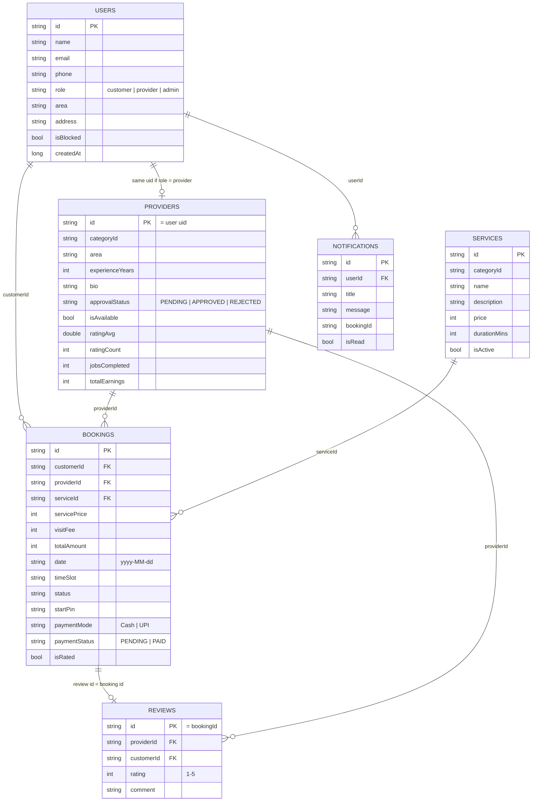
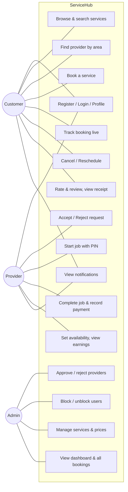
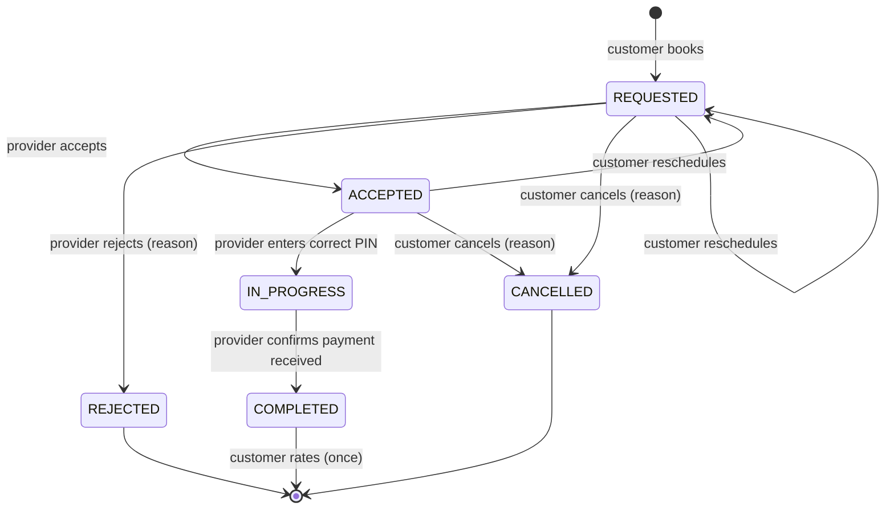
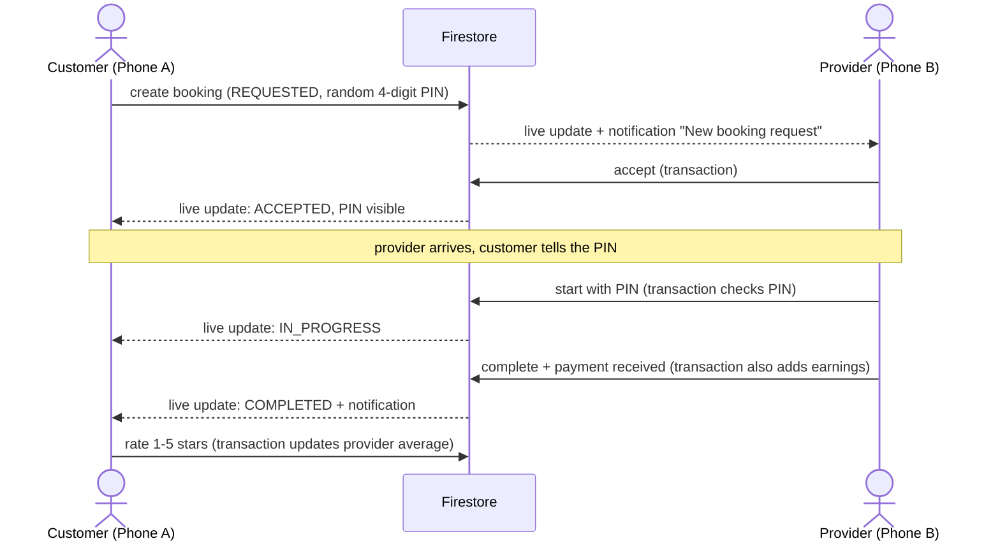

# ServiceHub – Report Kit

Diagrams are written in **Mermaid**. GitHub shows them as pictures automatically.
For your report: open this file on GitHub (or paste a diagram into https://mermaid.live),
then take a screenshot or export PNG.

---

## 1. Problem and solution (for the introduction)

Finding reliable local service providers is unorganized: people rely on word of mouth, cannot
compare prices, and cannot track a request. Providers have little digital visibility.
ServiceHub lets customers browse services with fixed prices, book an admin-verified provider in
their area and follow the job live, while providers manage requests and earnings and an admin
keeps the platform trustworthy.

## 2. Architecture (MVVM)

```mermaid
flowchart LR
    subgraph Phone["Android app (one Activity)"]
        UI["Screens<br/>(Jetpack Compose)"] -->|user actions| VM["ViewModels<br/>(StateFlow)"]
        VM -->|state| UI
        VM --> REPO["Repositories<br/>Auth · User · Service · Provider<br/>Booking · Review · Notification · Admin"]
    end
    REPO -->|login / logout| AUTH["Firebase Authentication"]
    REPO -->|read, write, transactions| FS[("Cloud Firestore")]
    FS -->|live updates (snapshot listeners)| REPO
    RULES["Security rules"] -.protect.- FS
```

**Explanation:** a screen only draws the state it gets from its ViewModel. The ViewModel holds
the screen's data in a StateFlow and calls a repository. Repositories are the only code that
talks to Firebase. Firestore pushes every change to all listening phones, so both phones stay in
sync without a refresh.

## 3. Firestore structure



Categories, areas and time slots are fixed lists in Kotlin code (`FixedData.kt`).
Names and phones are copied into each booking, so a booking still shows correct details even if
someone later edits their profile.

## 4. Use-case diagram



## 5. Booking status flow



Every move happens inside a **Firestore transaction** (`BookingRepository.changeBooking`): it
reads the current status and refuses any move that is not in the diagram.

## 6. Booking sequence (two phones)



## 7. Screenshot checklist

Take these on a real phone (Power + Volume down):

- [ ] Splash · Login · Register (customer) · Register (provider fields)
- [ ] Waiting for approval · Admin approvals list
- [ ] Customer Home (categories) · Search results · Category services
- [ ] Provider list with area chips · Provider detail with reviews
- [ ] Booking form with price summary · Booking success
- [ ] My Bookings (Active / Past) · Booking detail: Requested, Accepted with PIN, Completed
- [ ] Reschedule dialog · Cancel dialog
- [ ] Provider Home (availability + earnings) · Jobs (requests) · Job detail: PIN entry, Complete dialog
- [ ] Notifications with unread badge
- [ ] Rate & review · Receipt
- [ ] Admin dashboard · Users (block) · Manage services (edit price) · All bookings filter
- [ ] Firebase Console: Firestore collections · Authentication users list · Rules page

## 8. Future scope

- Push notifications (Firebase Cloud Messaging)
- Online payments (UPI intent / payment gateway)
- In-app chat between customer and provider
- Photos of the problem and provider ID verification documents
- Maps and GPS: show distance, live provider location
- A separate "busy slots" collection so bookings with personal details are readable only by their own customer and provider
- Server-side checks with Cloud Functions (needs the paid Blaze plan)
- Dark mode, Hindi/Gujarati languages, coupons and offers
- Provider working hours and custom slots

## 9. Likely viva questions (25) with short answers

1. **What problem does ServiceHub solve?** It replaces word-of-mouth with one app where customers see fixed prices, book an admin-verified provider in their area and track the job live.
2. **Why Kotlin and Jetpack Compose?** Kotlin is Google's preferred Android language (null safety, short code). Compose builds UI with Kotlin functions instead of XML and redraws automatically when state changes.
3. **Explain your architecture.** MVVM: Composable screen → ViewModel (holds StateFlow state) → Repository (talks to Firebase) → Firebase. Each layer has one job, so code is easier to test and change.
4. **What is a ViewModel?** A class that keeps a screen's data and logic. It survives screen rotation, so data is not lost, and the screen only displays its state.
5. **What is StateFlow?** A Kotlin Flow that always holds the latest value. The screen collects it and redraws whenever it changes.
6. **Why Firebase?** It gives login and a real-time cloud database without writing a server, and the Spark plan is free.
7. **Why Firestore and not Realtime Database?** Firestore has better queries, document/collection structure, transactions and clearer security rules.
8. **How do two phones stay in sync?** Each screen listens with a Firestore snapshot listener (wrapped in `callbackFlow`). When one phone writes, Firestore pushes the change to every listening phone in about a second.
9. **What is `callbackFlow`?** It converts a callback-based listener into a Kotlin Flow; `awaitClose` removes the listener when the screen no longer needs it.
10. **How does "stay logged in" work?** Firebase Auth stores the session on the phone. The Splash screen checks `currentUser`; if present, it reads the role and opens that home.
11. **How are roles handled?** `users/{uid}.role` is customer, provider or admin. After login the app reads it and opens the matching home with its own bottom bar.
12. **Why can't someone register as admin?** Admin is not offered at registration and the security rules refuse role "admin" on create. The admin role is set by hand in the Firebase Console.
13. **How does provider approval work?** New providers are saved with `approvalStatus = PENDING` and see a waiting screen. The admin approves or rejects; only approved, available, unblocked providers are shown to customers.
14. **How do you stop double booking?** Before saving, the app checks for an active booking (requested/accepted/in progress) of that provider on the same date and slot, and refuses if one exists.
15. **What is a Firestore transaction and where do you use it?** A group of reads and writes that succeeds or fails together, retrying if data changed meanwhile. Used for every status change, for completing a job (booking + earnings) and for ratings (review + average + isRated).
16. **Why the start PIN?** It proves the provider is actually at the customer's home before starting. The customer sees it only after acceptance; the job starts only with the correct PIN.
17. **How is the average rating calculated?** newAverage = (oldAverage × oldCount + newRating) / (oldCount + 1), inside a transaction so two reviews at once cannot give a wrong result.
18. **How do you prevent rating twice?** The review's document id is the booking id (only one can exist) and the booking gets `isRated = true`; the transaction refuses if either is already set.
19. **How do notifications work without push?** Important events write a document in `notifications` for the other person. Their app listens live and shows an unread badge; tapping marks it read.
20. **What happens when the admin blocks a user?** `isBlocked = true`: they are logged out immediately (the app listens to their own document), cannot log in again, blocked providers are hidden, and security rules refuse their writes.
21. **What do your security rules do?** Users edit only their own profile (never role or blocked status), only admin approves, blocks and edits services, only the booking's customer or provider can change it, reviews are once and cannot be edited, notifications are private.
22. **Why store customer and provider names inside the booking?** So a booking and receipt always show correct details without extra reads, even if someone changes their profile later (denormalization).
23. **How did you test the app?** 14 automatic logic tests (JUnit), Android lint (0 errors) and a 35-case manual test script on two real phones.
24. **What are the limitations?** No online payment, no push notifications, no GPS; bookings are readable by any logged-in user because of the slot check (future: separate busy-slots collection).
25. **What would you add next?** Push notifications, UPI payment, chat, maps, provider ID verification, and Cloud Functions for server-side checks.
